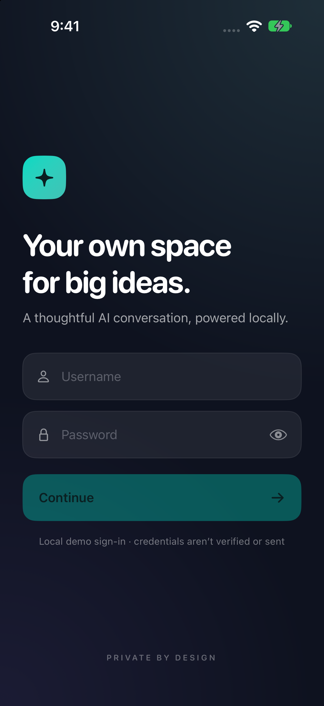

# Luma — iOSChatBot

A SwiftUI chat app for talking to a locally hosted Ollama model.



## How it works

- Continue past the demo sign-in screen. It is only a local UI gate; credentials are not verified or sent.
- The chat sends the conversation to Ollama’s `POST /api/chat` endpoint. The default endpoint is `http://localhost:11434` and the default model is `llama3.2`; both are editable under **Connection**.
- Attach a photo with the **+** button. The app resizes it and sends it with the message. Image questions require a vision model such as `llava`.
- The app requests notification permission at startup and can notify when a reply arrives. iOS permits only limited background time for an in-progress request.

## Run with Ollama

1. Install and start [Ollama](https://ollama.com/download).
2. Download a text model:

   ```sh
   ollama pull llama3.2
   ```

   For image questions, also download a vision model:

   ```sh
   ollama pull llava
   ```

3. In the app, open **Connection** and choose the installed model.
4. Use `http://localhost:11434` in the iOS Simulator. On a physical iPhone, use your Mac’s local network IP and configure Ollama to listen on the local network. Keep access restricted to a trusted network; Ollama’s local API does not authenticate users.

## Project status

This repository currently contains the app’s Swift source and assets. The Xcode project container is outside the repository, so a fresh clone is not yet a standalone buildable Xcode project.
